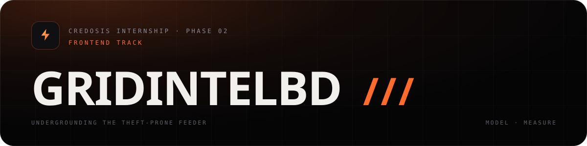

<p align="center">
  
</p>

<p align="center"><b>Bangladesh loses about a tenth of the power it distributes. This prices the fix.</b></p>

<p align="center"><i>Grid · Intel · BD — one urban network, priced in percentages and then measured on a pole.</i></p>

<p align="center"><sub>Built for the <b>Credosis Internship Program · Phase 02 · Frontend track</b></sub></p>

<p align="center">
  
  
  
  
</p>

<p align="center">
  <a href="https://skillicons.dev"></a>
</p>

**Two routes, one argument:** a scenario model that prices the decision, and a field rig that measures the loss it is pricing.

| Route | What it is |
| --- | --- |
| `#/` | **Simulator** — move the underground share and watch loss, recovered energy, unserved energy, savings and payback move together |
| `#/field` | **Field rig** — the same route twice, one span overhead and one ducted, metered at both ends |

- **Live demo:** _add your deployed URL here_
- **Walkthrough video:** _add your video URL here_

---

## The problem

Bangladesh's distribution system loses a large share of the power fed into it. Two
different things are hiding inside that number:

1. **Technical loss** — heat and impedance in conductors and transformers.
2. **Non-technical loss** — electricity that is consumed but never billed, mostly
   illegal hooking and meter tampering on open overhead lines.

Overhead lines are exposed twice: anyone with a ladder can tap them, and monsoon storms,
flooding and falling trees take them down. Underground cable removes the physical
opportunity for both — but it costs several times more per kilometre, and it means
digging up roads across a city.

So the real question is not "underground is better". It is:
**how much is bought back, where should the first phase start, and how long until it pays for itself?**

GridIntelBD is a small, honest attempt to answer that with numbers instead of adjectives.

---

## Features

### Core feature — scenario simulator

Four inputs drive the whole model:

| Control | What it represents |
| --- | --- |
| Network underground (0–100%) | Share of the 9,000 km urban network rebuilt as ducted cable |
| Theft on overhead lines (2–12%) | Non-technical loss on the sections still exposed |
| Monsoon severity (0.5–2.0×) | Multiplier on weather-driven outage hours |
| System peak demand (13,000–21,000 MW) | National evening peak, used to value avoided unserved energy |

Every number on the page is derived from a single pure function, `simulate(scenario)`, in
`src/lib/model.ts`. Nothing is hard-coded per panel, so the KPI cards, diagram, charts,
table and briefing note can never disagree with each other.

### Supporting features

1. **Live feeder diagram** — four feeders drawn from the substation outward. Each one is
   split at the exact point the underground cable has reached, so raising the slider
   physically pushes the duct further down the line, deletes the poles behind it and
   removes the illegal taps with them. Conversion follows load priority: the biggest
   feeder converts first.
2. **Loss breakdown** — where the 38,000 GWh entering the network ends up, today versus
   the current scenario, separated into delivered / technical / non-technical.
3. **12-month rollout projection** — unserved energy per month while conversion ramps,
   with the monsoon season visible in the shape of the curve.
4. **Auto-generated briefing note** — the current scenario rendered as a one-page note a
   decision maker would actually read, copyable in one click.

Presets (Today / Pilot 25% / Phase 1 40% / Full urban 70%) let a reviewer jump between
phases without touching the sliders.

### Second page — the field rig (`#/field`)

The model is only as good as its theft assumption. The field page stops assuming and
starts measuring: two spans on the same route, one overhead and one ducted, each metered at
**both** ends with class 0.5S CTs and GPS-synchronised clocks sampling every second.
Energy in minus energy out is the span loss — there is no model in the measurement path.

- **Live differential** — the headline figure is `span A − span B`, recomputed every tick.
- **Two channel cards** with a live trace each. Span A wobbles and spikes; span B is flat,
  because there is nothing to hook.
- **Injectable theft events** — "Inject a hook" fires a real event (kind, pole, duration,
  magnitude) into span A. The trace spikes, the rolling mean rises, and the detector log
  records it. Span B never moves.
- **Trend windows (1 min / 10 min / 1 h)** — the same event is obvious in a 1-minute view
  and nearly invisible in an hourly average. That is a property of measurement, not of theft.
- **Reconciliation panel** — the simulator's 11.6% overhead assumption against the meter's
  measured mean, with a verdict of `holds` / `model low` / `model high` against the
  instrument's ±0.35 pp uncertainty.
- **Phone screen** drawn in pure CSS, showing the same live reading with a working
  dark/light switch.

This is the page that makes the submission hard to dismiss: it is an instrument, not a
second dashboard, and it is honest about being simulated rather than field-installed.

---

## How the model works

All constants live in `MODEL` inside `src/lib/model.ts` and are shown in the collapsible
**Model assumptions & limitations** panel in the app.

```
share          = underground% / 100
technicalLoss  = lerp(6.4%, 2.6%, share)
theftLoss      = lerp(theft%, 0.8%, share)
loss           = technicalLoss + theftLoss

recoveredGWh   = 38,000 GWh × (lossToday − loss) / 100
value          = recoveredGWh × BDT 9.4/kWh

outageHours    = severity × lerp(190 h, 18 h, share)
unservedGWh    = outageHours × (peakMW × 0.62) / 1000
capex          = 240 crore + share × 9,000 km × 1.2 crore/km
payback        = capex / (energy value + outage value)
```

Monthly unserved energy multiplies the outage hours by a normalised seasonal profile
that peaks in the monsoon (June–September) and ramps the rollout linearly across the 12
months.

### Assumptions and limitations

These are stated plainly in the UI instead of being buried:

- Figures are **order-of-magnitude demonstration values**, not a bankable forecast. The
  model is a linear energy balance, not a load-flow simulation.
- Losses blend linearly between overhead and underground rates.
- Both benefits and capex scale with the converted share, so **payback is close to
  scale-invariant**. The real constraints are the capital budget and how fast trenches
  can be dug — not whether a single feeder pays for itself.
- Outage hours are valued at average load, not at peak, which understates their cost to
  households and industry.
- Programme cost does not include compensation, traffic management or revenue loss during
  construction.

---

## Run it locally

```bash
npm install
npm run dev        # http://localhost:5173
```

Production build:

```bash
npm run build      # type-checks with tsc -b, then bundles to dist/
npm run preview
```

### Deploy

The demo is a fully client-side static app — no backend or database is required, so it
deploys anywhere:

- **Netlify / Vercel:** build command `npm run build`, publish directory `dist`.
- **GitHub Pages:** push `dist/` (the Vite `base` is already `./`, so it works from a
  project sub-path).

`backend/` is an optional Node stub from an earlier iteration of the idea. It is not used
by this demo.

---

## Project structure

```
src/
  lib/
    model.ts        # constants + simulate(): the entire simulation
    field.ts        # rig constants, deterministic noise, span loss, theft events
    briefing.ts     # scenario -> plain-text briefing note
    route.ts        # hash router (#/ and #/field)
    useReveal.ts    # scroll reveal + card spotlight
    format.ts       # number formatting
  pages/
    SimulatorPage.tsx    # the undergrounding model
    FieldTestPage.tsx    # the A/B measurement rig
  components/
    ControlPanel.tsx     # the four scenario sliders
    NetworkDiagram.tsx   # SVG feeder conversion visual
    LossBreakdown.tsx    # stacked loss bar
    TrajectoryChart.tsx  # 12-month unserved energy chart
    ComparisonTable.tsx  # today vs scenario
    BriefingNote.tsx     # generated note + copy to clipboard
    MethodSheet.tsx      # light closing sheet: method, constants, caveats
    Panel.tsx            # shared Kairo card (spotlight + reveal)
    RigDiagram.tsx       # two spans, four meters, one logger
    ChannelCard.tsx      # per-span live readout
    TraceChart.tsx       # loss-versus-time trace
    MeterPhone.tsx       # CSS phone with the meter app
    KrNav.tsx, KrFooter.tsx, KpiCard.tsx, Icons.tsx
  App.tsx           # shell + routing
  index.css         # Kairo import + GridIntelBD surfaces (gs-*)
  styles/kairo.css  # InstaLanding design system, kairo@1.0.0 (vendored)
assets/
  banner.svg        # README header
```

No charting library: every chart, diagram and trace is hand-authored SVG or CSS, so they
stay crisp, responsive and consistent with the design tokens.

---

## Design system

The UI is built on **Kairo `kairo@1.0.0`** (InstaLanding): near-black cards on a masked
72 px grid, one hot orange with a peach partner, four soft signal colours (violet, mint,
sky, rose) used semantically rather than decoratively, Inter Tight for display, JetBrains
Mono for every label and figure.

- `src/styles/kairo.css` is the system stylesheet, **vendored unmodified** and versioned in
  its header comment. Tokens live on `:root`; components are scoped under `.kr` with `kr-`
  class names.
- `src/index.css` only adds the handful of surfaces the system does not ship — range
  inputs, the instrument scope, the data table, schematic SVG type — all under a `gs-`
  prefix and all consuming `--kr-*` tokens. No new colours.
- Reused components rather than look-alikes: `.kr-nav`, `.kr-card` (pointer spotlight and
  hairline border), `.kr-bento` sizing, `.kr-btn-*`, `.kr-eyebrow` with its pulsing dot,
  `.kr-tag`, `.kr-stat-num` gradient figures, `.kr-light-sec` paper sheet, `.kr-wordmark`,
  `.kr-phone` / `.kr-app` app screen, `.kr-theme-switch`.
- Motion is on `--kr-ease` and stops entirely under `prefers-reduced-motion`; the reveal
  system adds `.kr-in` from an IntersectionObserver and falls back to visible if the API is
  missing, so content is never left hidden.
- Colour carries meaning: orange is loss and leakage, mint is the sealed duct, rose is the
  illegal tap, sky is technical loss.

---

## Walkthrough video script (3–5 minutes)

| Time | Beat |
| --- | --- |
| 0:00–0:35 | **Problem.** Bangladesh loses roughly a tenth of distributed power. Split it into technical loss and theft on open overhead lines, and note that storms take those same lines down. Undergrounding fixes both — but it is expensive and disruptive. |
| 0:35–1:10 | **What this is.** One urban network, 9,000 km, 38,000 GWh/yr. A simulator that prices the trade-off instead of arguing about it. |
| 1:10–2:45 | **Core demo.** Start at "Today": 11.6% loss, illegal taps visible on every feeder, 190 outage hours. Drag the underground slider slowly — point out the duct advancing from the substation, poles disappearing, taps vanishing. Land on 40% and read the KPIs: 8.3% loss, 1,246 GWh recovered, BDT 1,171 crore/yr, payback ~2.5 years. Then raise monsoon severity and show outage hours moving without touching anything else. |
| 2:35–3:10 | **Supporting features.** Loss breakdown (how much of the drop is theft versus heat), the 12-month monsoon chart, and the briefing note — copy it to show it is real text, not an image. |
| 3:10–4:05 | **Field rig — the differentiator.** Switch to `#/field`. Two spans, four meters, one logger. Read the differential, then hit "Inject a hook": span A spikes, its rolling mean climbs, the detector log records the event, and span B does not move at all. Switch the trend to 1 h and show the same event nearly vanish — that is why theft is under-reported. Finish on the reconciliation panel: the model said 11.6%, the meter says 11.7%. |
| 4:05–4:35 | **Challenges.** (1) No public feeder-level loss data, so the model had to be a defensible blend with every assumption exposed in the UI. (2) The diagram is not a static image — each feeder is split at its own conversion boundary and re-rendered per change. (3) Making a differential measurement read as an instrument rather than a chart. (4) Keeping six surfaces numerically consistent by deriving all of them from one pure function. |
| 4:35–5:00 | **Next.** Real DISCO loss data per feeder, a load-flow model instead of a linear blend, sequencing phases by cost per recovered MWh, and a live pilot rig to replace the assumed theft rate with a measured one. |

### Numbers to be able to explain

- Why the "today" baseline moves when the theft slider moves: the baseline is the *same
  network with nothing underground*, so it stays a fair like-for-like comparison.
- Why payback barely changes with scale: both benefit and capex are linear in the
  converted share (see limitations above).
- Why underground beats overhead even at equal loss: most of the gain here is
  non-technical loss disappearing, plus the outage hours.
- Why the rig measures at **both** ends of both spans: a single meter cannot separate what
  the customer consumed from what was taken off the wire. Four points and a synchronised
  clock can.
- Why a 1-hour view hides a 40-second hook: averaging is a low-pass filter. Long windows
  make theft look small, which is exactly how a utility under-reports it.
- Why the reconciliation says "holds": the gap is inside the ±0.35 pp differential
  uncertainty of two class 0.5S meters. Being inside your own error bar is not a weak
  result — it is the only honest one.

---

## Tech

React 19 · TypeScript · Vite · Tailwind CSS · Kairo `kairo@1.0.0` design system ·
hand-authored SVG/CSS visuals · hash routing for static hosting · reduced-motion and
keyboard support throughout.
